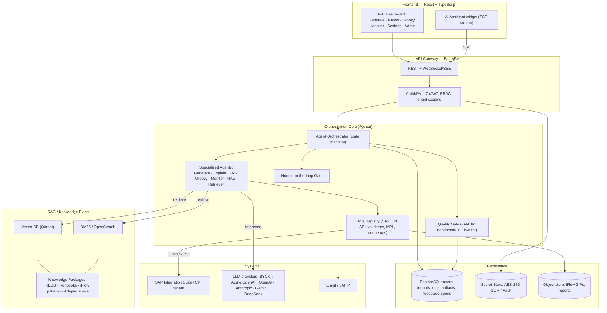
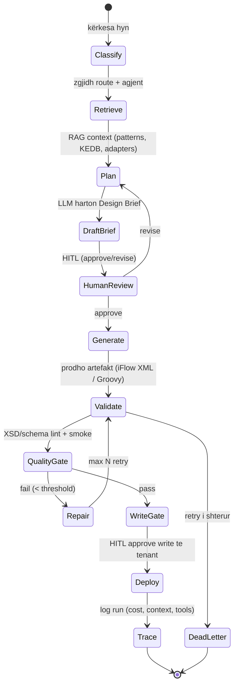
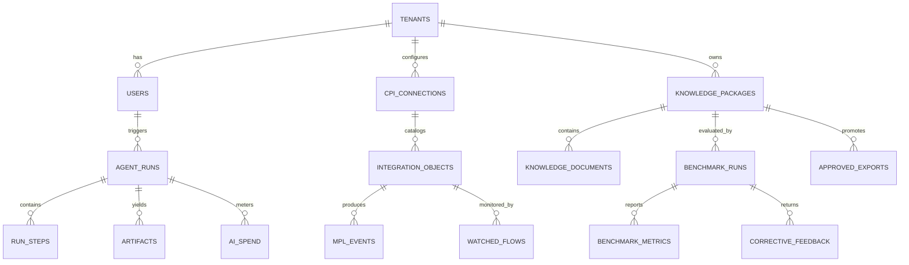
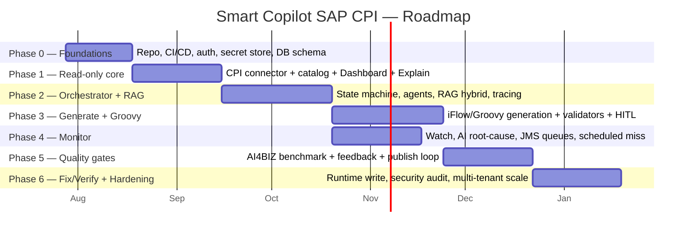

# Smart Copilot for SAP CPI — Arkitektura & Roadmap

> **Version:** 0.1 (draft) · **Data:** 2026-08-25 · **Owner:** Ilirjan Rexho
> **Stack i zgjedhur:** Backend **Python / FastAPI** · Frontend **React + TypeScript**
> **Orkestrimi:** Multi-agent orchestrator + RAG grounding + AI4CPI quality gates (i kombinuar)
> **Qëllimi i fazës 1 (MVP):** Full platform (Dashboard, Generate, iFlows, Groovy, Monitor, Settings, Admin)

Ky dokument është plani zyrtar që do të ndjek për të ndërtuar një version të përmirësuar të modelit "CPI Copilot", me fokus te **orkestrimi i qëndrueshëm i AI-së**, **grounding me RAG mbi njohuritë SAP CPI**, dhe **quality gates** që parandalojnë halucinacionet përpara se AI të prekë tenant-in e klientit.

---

## 1. Përmbledhje ekzekutive

Aplikacioni model (`cpicopilot.com`) është një **AI co-pilot për SAP Cloud Integration (CPI / Integration Suite)** që mbulon gjashtë module: Dashboard, Generate (iFlow nga gjuha natyrale), iFlows (browse / Explain / Modify / Fix / Verify), Groovy (gjenerim skriptesh), Monitor (watch + AI root-cause + JMS queue health), dhe Settings/Admin (kredencialet OAuth, AI engine BYOK, email alerts, users/spend).

Vlerësimi im: modeli është i fortë në **mbulim funksional**, por dobësia kryesore — dhe pikërisht aty ku ti do ta përmirësosh — është **orkestrimi**. Në modelin origjinal çdo veprim AI (Generate, Explain, Fix) duket si një thirrje e vetme LLM me pak grounding. Kjo prodhon dy rreziqe në SAP: (1) **halucinacione** në emra adaptera, mapping fields, endpoint URL, dhe (2) **veprime write të pakontrolluara** ndaj tenant-it prodhues.

Propozimi im e zgjidh këtë me tre shtresa: një **orchestrator me agjentë të specializuar** (state machine + tool-calling + human-in-the-loop), një **shtresë RAG** që ushqen çdo agjent me njohuri të qeverisura (KEDB, runbooks, iFlow patterns, adapter specs), dhe **quality gates AI4BIZ** që bllokojnë promovimin e artefakteve nën një threshold. Kjo e kthen "një chatbot që gjeneron XML" në një **platformë të qeverisur closed-loop**.

---

## 2. Analiza e aplikacionit model

### 2.1 Modulet dhe funksionet (nga URL + 7 screenshots)

| Modul | Funksioni kryesor | Statusi (sipas UI) | Rreziku SAP |
|------|-------------------|--------------------|-------------|
| **Dashboard** | KPI: Total iFlows, Packages, Watched, Failing; Quick Actions; Recent iFlows; Flow Health | Live | I ulët (read-only) |
| **Generate** | iFlow nga description → *Analyse and Plan* → Design Brief → *Generate from Plan*; ose *Quick Generate* | Beta | I lartë (write në tenant) |
| **iFlows** | Browse sipas package; *Explain from ZIP*; Modify / Fix / Verify | Explain stable, tjerat beta | I lartë (Modify/Fix write) |
| **Groovy** | Gjenerim skriptesh Groovy nga logjika në gjuhë natyrale | Beta | I mesëm (script injection) |
| **Monitor** | Watch flows; AI root-cause në email; "Ask your monitoring" (NL→query); JMS queue health; scheduled-flow miss detection | Stable | I mesëm (queue actions = write) |
| **Settings** | CPI Connection (OAuth service key), CPI Runtime (RT key), Email (SMTP/shared), AI Engine (BYOK: Azure OpenAI/OpenAI/Anthropic/Gemini/DeepSeek), AES-256-GCM at rest | — | Kritik (secret handling) |
| **Admin** | Users active, AI Spend (month/total), CPI Connected, Recent AI Activity | — | I mesëm (multi-tenant isolation) |

### 2.2 Modeli i sigurisë i observuar (i mirë, e mbajmë)

Modeli origjinal ndan **design-time key** (CPI Connection) nga **runtime key** (CPI Runtime, vetëm për Fix/Verify), përdor **read-only scope** për monitoring, dhe **AES-256-GCM per-account master key** për secrets. Kjo ndarje është korrekte dhe do ta ruajmë dhe forcojmë.

### 2.3 Boshllëqet që do t'i mbulojmë (përmirësimet)

1. **Mungon grounding i qeverisur.** Gjenerimi mbështetet te LLM knowledge, jo te patterns/adapter specs të verifikuara → RAG layer.
2. **Orkestrim i cekët.** "Analyse and Plan → Generate" është linear; mungon retry/repair loop, tool-validation, dhe kontroll deterministik → orchestrator me state machine.
3. **Nuk ka quality gate përpara write.** Asnjë benchmark/lint përpara se artefakti të shkojë në tenant → AI4BIZ quality gates + validim iFlow (XSD/schema).
4. **Observability e AI-së.** Spend tracking ekziston, por mungon trace-i i plotë i çdo run-i (input, retrieved context, tool calls, cost, latency) → run history + tracing.
5. **Human-in-the-loop i pjesshëm.** "Unlock before generating" është manual; mungon një approval workflow strukturor për veprimet write → HITL gate në orchestrator.

---

## 3. Propozimi im — Arkitektura e orkestrimit të përmirësuar

### 3.1 Pamje e përgjithshme (C4 — kontejnerët)



### 3.2 Orkestrimi si state machine (zemra e përmirësimit)

Çdo kërkesë (p.sh. "Generate iFlow") kalon nëpër një makinë gjendjesh deterministike, jo një thirrje të vetme LLM. Kjo jep retry të kontrolluar, validim përpara write, dhe një pikë të vetme HITL.



Parimet e orkestrimit që do të zbatojmë:

- **Deterministic control, probabilistic steps.** Kalimet mes gjendjeve i vendos orchestrator-i (kod), jo LLM-ja. LLM përdoret vetëm brenda hapave (Plan, Draft, Repair).
- **Tool-calling i tipizuar.** Çdo tool ka schema Pydantic input/output; asnjë tool nuk merr string të lirë për parametra kritikë (interface_id, package_id).
- **RAG i detyrueshëm për operacione.** Përgjigjet operacionale (Explain, Fix, root-cause) kërkojnë retrieved context; përndryshe kthehet "insufficient evidence" në vend të halucinacionit.
- **HITL përpara çdo write.** Deploy/Modify/Fix/Queue-action kalojnë gjithmonë nga një approval gate — vazhdon praktikën "Unlock before" të modelit, por strukturor.
- **Full trace.** Çdo run ruan: input, route, retrieved chunks (me document_id/section/chunk), tool calls, LLM provider+model, tokens, cost, latency, dhe outcome.

### 3.3 Grounding me RAG (pse rrit saktësinë)

Ndjekim pipeline-in hybrid të AI4BIZ: normalizim query me ruajtje të fragmenteve literal (error strings), **BM25** mbi title/metadata/headings/body, **vector retrieval** mbi chunk body + metadata-enriched text, merge + rerank sipas fushave të pritura (error signature, object_name, interface_id, integration_flow_id, priority), dhe citime me document_id/section/chunk. Chunking është **heading-aware** për KEDB/runbooks (jo fixed-size për dokumente normative).

### 3.4 Quality gates (AI4BIZ closed-loop)

Përpara promovimit të një artefakti (ose knowledge package), aplikohen kategoritë me pesha: Ingestion Policy Compliance 20%, BM25 Authoring 15%, Chunking 15%, Retrieval Precision 20%, Retrieval Recall 15%, Answer Faithfulness 10%, Citation Accuracy 5%. Thresholds: ≥90 Enterprise Ready, 80–89 minor, 70–79 conditional, 60–69 needs remediation, <60 not ready. Platforma e vlerësimit **nuk e modifikon** dokumentin — prodhon **corrective feedback JSON**; regjenerimi bëhet në gjenerator vetëm pas aprovimit të përdoruesit.

---

## 4. Arkitektura e Backend-it (FastAPI)

### 4.1 Kufijtë e shërbimeve (service boundaries)

```
app/
  api/                # FastAPI routers (REST + SSE/WebSocket)
  auth/               # JWT, RBAC, tenant scoping
  orchestrator/       # state machine, run engine, HITL gates
  agents/             # generate, explain, fix, groovy, monitor, retriever
  tools/              # sap_cpi_client, iflow_validator, groovy_linter, mpl_reader, queue_ops
  rag/                # document_loader, markdown_parser, chunking, indexing, retrieval, rag_eval
  quality/            # policy_compliance, benchmark, feedback_generator, report_generator
  connectors/         # SAP CPI OData/REST, SMTP, LLM provider adapters
  persistence/        # SQLAlchemy models, repositories, migrations (Alembic)
  security/           # secret store (AES-256-GCM / Vault), crypto, audit
  observability/      # tracing, cost metering, structured logging
  workers/            # Celery/RQ: monitoring polls, benchmark runs, scheduled checks
```

Këta kufij pasqyrojnë udhëzimet AI4BIZ (`document_loader`, `markdown_parser`, `policy_compliance_service`, `chunking_service`, `indexing_service`, `retrieval_benchmark_service`, `rag_evaluation_service`, `feedback_generator`, `report_generator`, `publishing_service`) të zgjeruar me orchestrator, agjentë, dhe connectors.

### 4.2 Modeli i të dhënave (PostgreSQL — baseline)



Tabelat kyçe: `tenants`, `users`, `cpi_connections` (secrets me referencë te secret store, jo plaintext), `integration_objects` (package_id, iflow_id, adapters, ruaj IDs **ekzakt**), `mpl_events`, `agent_runs` (route, status, provider, model, tokens, cost, latency), `run_steps` (state, tool calls, retrieved chunks), `artifacts` (iFlow ZIP / Groovy, version), `watched_flows`, `knowledge_packages`, `knowledge_documents`, `benchmark_runs`, `benchmark_metrics`, `corrective_feedback`, `approved_exports`, `ai_spend`, `audit_log`. Indekse mbi: package_id, run_id, document_id, source_system, artifact_type, priority, timestamps.

### 4.3 Vector store (Qdrant)

Point IDs stabël të derivuar nga `package_id + document_id + section_id + chunk_id`; upsert idempotent; payload filterable: `customer_id, system_id, sap_sid, artifact_type, priority, interface_id, integration_flow_id, object_name, review_status, version`; hybrid me BM25/OpenSearch. Embedding model boundary konfigurueshëm (BYOK).

### 4.4 Sipërfaqja e API-t (draft)

```
POST /auth/login · /auth/refresh
GET  /dashboard/kpis
POST /agent/generate-iflow      # → run_id (SSE stream)
POST /agent/explain             # from tenant iflow OR uploaded ZIP
POST /agent/fix                 # HITL-gated
POST /agent/groovy
GET  /runs/{run_id}             # full trace
POST /runs/{run_id}/approve     # HITL gate (brief / write)
GET  /iflows?package=...        # catalog
GET  /monitor/flows · POST /monitor/watch · POST /monitor/ask   # NL→query
POST /monitor/queue-actions     # retry/move/delete — double-confirm
GET/POST /settings/connection · /settings/ai-engine · /settings/alerts
POST /knowledge/packages · POST /knowledge/benchmark · GET /knowledge/feedback/{id}
POST /knowledge/publish         # only if score ≥ threshold
GET  /admin/users · /admin/spend
```

### 4.5 Async & workers

Monitoring polls, scheduled-flow miss detection, dhe benchmark runs janë long-running → **Celery/RQ + Redis**. Streaming i përgjigjeve AI te frontend-i përmes **SSE**. Idempotency keys për të gjitha veprimet write ndaj tenant-it.

---

## 5. Arkitektura e Frontend-it (React + TypeScript)

- **Stack:** React + TypeScript, Vite, TanStack Query (server state), Zustand (UI state), Tailwind, shadcn/ui, React Router. Testim: Vitest + Playwright.
- **Struktura:** feature-based (`features/dashboard`, `/generate`, `/iflows`, `/groovy`, `/monitor`, `/settings`, `/admin`) + `components/ui` të përbashkët.
- **Streaming:** AI Assistant + Generate/Explain lexojnë SSE nga `/agent/*` dhe `/runs/{id}` për të treguar hapat e orchestrator-it live (Classify → Retrieve → Plan → Validate → Gate).
- **HITL UX:** Design Brief me butona *Revise / Approve*; "Unlock before write" bëhet një modal approval strukturor me diff preview (para/pas) përpara deploy.
- **Run trace viewer:** panel që tregon retrieved citations, tool calls, cost, latency — transparencë kundër halucinacioneve.
- **Aksesueshmëri & i18n:** English default, German + Albanian të zgjedhshme (përputhet me AI4BIZ).

---

## 6. Roadmap i fazuar



**Phase 0 — Foundations (≈3 javë).** Monorepo (backend/frontend), CI/CD, FastAPI skeleton, JWT+RBAC, tenant model, secret store (AES-256-GCM ose Vault), PostgreSQL schema + Alembic, observability bazë. *Deliverable:* login funksional + health checks + skema e DB.

**Phase 1 — Read-only core (≈4 javë).** SAP CPI connector (OData/REST, read-only scope), katalogimi i integration objects, Dashboard KPI, **Explain** (nga tenant + nga ZIP). Fillojmë read-only sepse është më i sigurt dhe në modelin origjinal është pjesa "stable". *Deliverable:* Dashboard + Explain live.

**Phase 2 — Orchestrator + RAG (≈5 javë).** State-machine engine, agent registry, tool registry me schemas, RAG pipeline (loader→parser→chunking heading-aware→BM25+Qdrant→hybrid rerank), run tracing + cost metering, BYOK LLM adapters. *Deliverable:* çdo veprim AI kalon nga orchestrator me citime.

**Phase 3 — Generate + Groovy (≈5 javë).** Generate iFlow (Analyse&Plan → Brief → Generate from Plan), Groovy generator, iFlow validator (XSD/schema lint), Groovy linter, HITL approval + diff preview. Ende **pa write** te tenant deri te WriteGate. *Deliverable:* artefakte të validuara + download ZIP.

**Phase 4 — Monitor (≈4 javë, paralel me P3).** Watch flows, AI root-cause në email, "Ask your monitoring" (NL→SQL/OData të kufizuar), JMS queue health, scheduled-flow miss detection, alert digests. *Deliverable:* monitoring me alerts.

**Phase 5 — Quality gates & closed loop (≈4 javë).** Benchmark service (7 kategoritë me pesha), corrective feedback JSON, report generator (DOCX/PDF/XLSX), publish gate me threshold. *Deliverable:* knowledge package publikohet vetëm nëse ≥ threshold.

**Phase 6 — Fix/Verify + Hardening (≈4 javë).** Runtime key për Fix/Verify (write i vërtetë te tenant me double-confirm), security audit, load/multi-tenant scaling, penetration test i secret handling. *Deliverable:* platformë prodhuese e qeverisur.

---

## 7. Vendimet teknologjike (të propozuara)

| Shtresa | Zgjedhja | Arsyeja |
|--------|----------|---------|
| API | FastAPI + Pydantic v2 | Tipizim i fortë për tool schemas, async, SSE |
| Orchestration | Kod deterministik (opsionale LangGraph) | Kontroll i kalimeve në kod, jo te LLM |
| RAG | Qdrant + OpenSearch (BM25) | Hybrid retrieval sipas AI4BIZ |
| DB | PostgreSQL + Alembic | Governance, run history, JSONB ku duhet |
| Queue | Celery/RQ + Redis | Monitoring polls, benchmark runs |
| Secrets | AES-256-GCM per-account / Vault | Përputhet me modelin origjinal, forcuar |
| LLM | BYOK adapters (Azure/OpenAI/Anthropic/Gemini/DeepSeek) | Prompt-et nuk dalin nga provideri i klientit |
| Frontend | React + TS + Vite + TanStack Query + Tailwind/shadcn | Prodhueshmëri + SSE streaming |
| Deploy | Docker + (K8s/BTP), 12-factor | Portabilitet |

---

## 8. Siguria & qeverisja

Ndarje design-time/runtime keys (write vetëm në Phase 6); read-only scope si default për discovery/monitoring; secrets kurrë në plaintext, kurrë të echo-uar te browser-i; **audit_log** për çdo veprim write; HITL i detyrueshëm përpara Deploy/Fix/queue-actions; ruajtje **ekzakte** e enterprise IDs (interface_id, integration_flow_id, package_id) — asnjë rename pa kërkesë eksplicite; hallucination controls (retrieved context i detyrueshëm, citime, ndarje fakt vs rekomandim).

---

## 9. Risqe & pika të hapura

- **Akses te tenant-i SAP CPI.** Nuk kemi ende service key real → Phase 1 kërkon një tenant test (trial) ose export ZIP për të validuar connector-in. *(assumption)*
- **Saktësia e gjenerimit të iFlow-ve.** iFlow XML është kompleks; validatori (XSD/schema) është kritik. Mund të duhet një bibliotekë patterns e kuruar për grounding. *(open point)*
- **Kosto e LLM-së.** BYOK e zbut, por benchmark runs mund të jenë të shtrenjta → cache + batch. *(risk)*
- **Golden question dataset.** Retrieval/faithfulness metrics kërkojnë query set + expected docs; pa to raportojmë vetëm policy/BM25/chunking readiness. *(missing input)*
- **Multi-tenant isolation.** Duhet dizajnuar nga Phase 0 (row-level security ose schema-per-tenant). *(decision needed)*

---

## 10. Traceability / Source Map

| Burimi | Përdorimi në këtë dokument |
|--------|----------------------------|
| `cpicopilot.com/app` (web fetch) | Modulet, funksionet, tekstet e UI, Settings/AI Engine, monitoring |
| 7 screenshots (Dashboard, Generate, iFlows, Groovy, Monitor, Settings x2) | Konfirmim i layout-it, KPI, "Unlock before", queue actions, BYOK |
| Skill `ai4biz-platform-context.md` | Closed-loop orchestration, three-platform ecosystem, shared contract |
| Skill `python-data-ai-engineering.md` | Service boundaries, PostgreSQL baseline, vector design, hybrid retrieval, hallucination controls |
| Vendimet e përdoruesit (AskUserQuestion) | Stack FastAPI+React, orkestrim i kombinuar, full-platform MVP, Markdown+diagrame |

> **Statusi i fushave:** `source-backed` = nga UI/skill; `derived` = konkluzion imi mbi orkestrimin; `assumption` = shënuar te seksioni 9. Asnjë MPL field, endpoint URL, apo adapter setting nuk është i fabrikuar.

